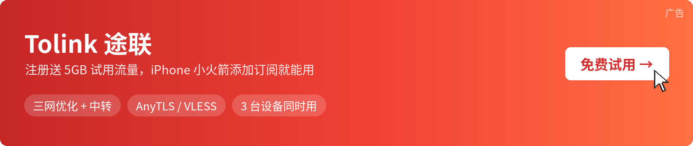

### 🚀最后更新时间: 2026-11-22 04:54:16

# Tolink 小火箭免费节点（Shadowrocket / iPhone）

本仓库自动更新 Tolink 的公益免费订阅，iPhone、iPad 上的 Shadowrocket（小火箭）添加订阅就能用。

- 公益流量用完后，脚本会自动换上新的订阅链接，最后更新时间见第一行。
- 节点全部超时，回本页复制新链接，在小火箭里重新更新订阅。

[](https://6no2fh.tolinkaff2.com/jbG53QUi)

| Tolink 途联 | 注册送 5GB 试用流量 · 三网优化 + 中转 · AnyTLS / VLESS · iPhone / iPad 小火箭可用 | [点击注册 Tolink →](https://6no2fh.tolinkaff2.com/jbG53QUi) |
|---|---|---|

## 小火箭免费订阅链接

>🚀免费iOS小火箭订阅链接（Shadowrocket，iPhone / iPad 通用）

```
https://n5Xp7q.tosslk.xyz/af1e5fa33b604db3cb4390035ff1def7
```

## 先装好 Shadowrocket

- 只从 [App Store](https://apps.apple.com/us/app/shadowrocket/id932747118) 安装，是付费应用。中国大陆区的 App Store 搜不到，要用其他地区的 Apple ID 登录 App Store 下载。
- 版本要 2.2.64 或更新，才能用 AnyTLS 节点；旧版本只能用其中的 VLESS 节点。在 App Store 里点「更新」就行。
- 网上的「小火箭免费下载」「共享 Apple ID」来路不明，账号可能被锁，不建议用。

## 小火箭添加订阅（4 步）

1. 复制上面的订阅链接，打开 Shadowrocket，点首页右上角的「+」。
2. 「类型」选「Subscribe」，把链接粘贴到「URL」，「备注」填个好认的名字，点右上角「完成」。
3. 回到首页，在这条订阅上向右滑，点「更新」，节点就会出现在列表里。
4. 点首页底部的「连通性测试」，选一个有延迟数字的节点，再打开顶部的连接开关。第一次会弹出「添加 VPN 配置」，点「允许」并输入手机密码。

「全局路由」保持「配置」（按规则分流，国内网站不走代理），一般不用改。

## 让小火箭自己更新订阅

免费链接会换，每次手动更新容易忘：

- 设置 → 订阅 → 打开「打开时更新」：每次重新打开小火箭都会自动更新一次。
- 设置 → 订阅 → 打开「自动后台更新」：还要在 iPhone 的 设置 → 通用 → 后台 App 刷新 里允许 Shadowrocket。

## 免费订阅的实际限制

- **多人共用**：晚上人多时速度明显下降，连通性测试经常超时。
- **链接会换**：流量用完就换新链接，旧链接失效后要回本页重新复制。
- **只适合临时用**：查资料、看网页够用，长期用手机办公、看视频建议用自己的账号。

想长期稳定用，可以注册自己的 Tolink 账号，拿到专属订阅，按上面同样的方法加进小火箭；一个账号 3 台设备同时用，iPhone、iPad 和电脑可以一起用。注册就送 5GB 试用流量，先试再决定：

| Tolink 途联 | 注册送 5GB 试用流量 · 三网优化 + 中转 · AnyTLS / VLESS · 3 台设备同时用 | [点击注册 Tolink →](https://6no2fh.tolinkaff2.com/jbG53QUi) |
|---|---|---|

## 常见问题

**更新订阅后列表还是空的？**<br/>
先确认链接复制完整（从 `https://` 开头到最后一个字符，前后没有空格）；再回本页看第一行的更新时间，复制最新链接，编辑这条订阅把旧链接换掉再更新。

**有的节点显示不支持或连不上？**<br/>
订阅里有 AnyTLS 和 VLESS 两种节点，AnyTLS 需要 Shadowrocket 2.2.64 及以上版本。去 App Store 把小火箭更新到最新版就好。

**打开连接开关后马上又断开？**<br/>
多半是第一次没点「允许」添加 VPN 配置。到 iPhone 的 设置 → 通用 → VPN 与设备管理 里删掉 Shadowrocket 的配置，回小火箭重新打开开关，按提示允许。

**多久更新一次？**<br/>
不按固定时间。脚本会自动检测，链接的流量用完就换上新的，所以一天可能更新好几次，以第一行的时间为准。

**安卓手机或电脑能用吗？**<br/>
订阅链接本身通用，但小火箭只有苹果设备版本。安卓和电脑可以装 FlClash，导入方法见 [FlClash 教程](https://volya2026.github.io/proxy-client-guide/flclash/)。

## 延伸阅读

- [Tolink 机场评测](https://tuijianvpn.com/1134)：套餐、线路和使用体验的完整介绍。
